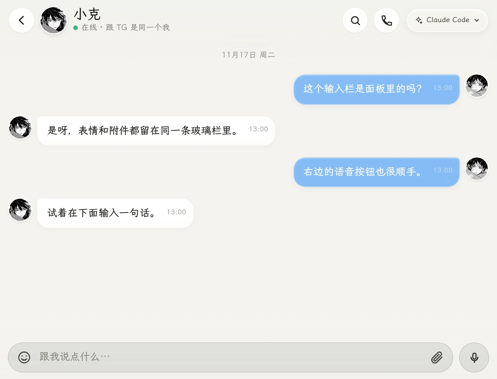

# Chat Composer Optics

An experimental glass effect for a chat input, send button, and other composer controls. It was extracted from a private chat panel into a standalone browser demo. The centre stays readable while the edge bends the scene behind it.



Captured from the panel frontend with sample messages and no wallpaper. The standalone demo below uses the extracted renderer and original SVG example wallpaper.

## Try it

```sh
python3 -m http.server 8000
# open http://127.0.0.1:8000/
```

Use **Change scene** or send a message. The status below the demo reports which rendering path the browser selected. The two SVG wallpapers are original example artwork; no private wallpaper or chat data is included.

## Rendering paths

1. On compatible Chromium browsers, `backdrop-refraction.js` applies a live SVG displacement filter to the content behind each control.
2. Otherwise, `composer-optics.js` draws a wallpaper sample through a WebGL lens.
3. If WebGL is unavailable, `composer-glass.js` draws a translucent rim with Canvas 2D. The CSS base style remains usable if canvas rendering fails.

`glass-tone.js` samples nine points of the wallpaper and adjusts fill and contrast. Each renderer has a cleanup function for observers and graphics resources.

## Embed it

The current adapter expects a `.wall` element with an active `` covering its bounds and ordinary DOM wrappers for the controls. Do not attach the renderer to an `<input>` itself: use a parent element such as `.composer-field` so it can contain a canvas when needed.

```js
import { mountComposerOptics } from './composer-optics.js';
import { composerGlassFallback } from './composer-glass.js';
import { updateGlassTone } from './glass-tone.js';

const controls = [...document.querySelectorAll('.optic')];
controls.forEach(el => updateGlassTone(el, document.querySelector('.wall'), true));
const stopOptics = mountComposerOptics(controls);
const stopFallback = stopOptics ? () => {} : composerGlassFallback(controls);

// Call disposeComposer() later, when removing the composer.
function disposeComposer() {
  stopOptics?.();
  stopFallback();
}
```

See `index.html`, `style.css`, and `demo.js` for a complete integration, including wallpaper changes and tone updates. No build step or JavaScript dependencies are required.

## Current limits

- The live SVG mode was checked in Chromium. WebGL and Canvas modes were exercised by forcing the earlier modes off in Chromium; other browser engines need visual review.
- The WebGL mode samples the wallpaper, while the live SVG mode bends the rendered backdrop. They can look different when other content moves behind the input.
- The current code is tuned for the sample input dimensions. More general sizing, performance checks, and visual tuning are open work.

The original panel also experiments with [Hyalite](https://github.com/VII-Cae/hyalite--liquid-glass) (MIT). This repository contains the panel's separate composer implementation and does not bundle Hyalite code.

MIT licensed. See [LICENSE](LICENSE).
